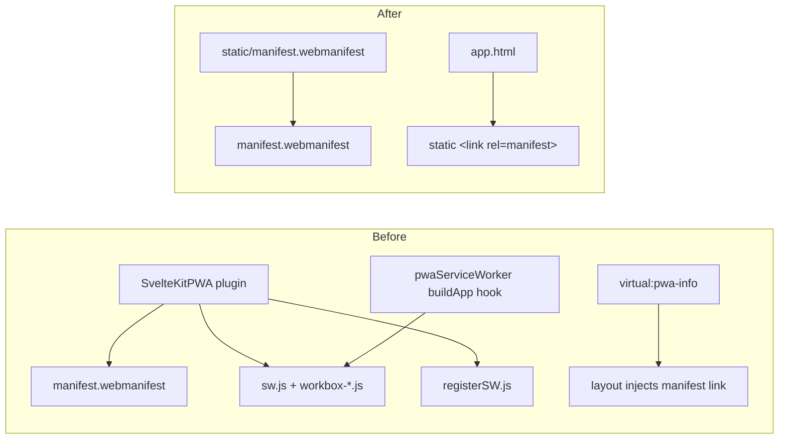

## Context

The public site gets its PWA support from `@vite-pwa/sveltekit`, which does two jobs: it
generates the web app manifest, and it generates a workbox service worker. Under
SvelteKit 3 the plugin's own service-worker step never fires, so `vite.config.ts` carries
a custom `buildApp` hook (`pwaServiceWorker()`) that calls the plugin's `generateSW()`
API, plus `outDir` and `kit.base` overrides to make it emit into the right place.
`src/routes/+layout.svelte` injects only the manifest link from `virtual:pwa-info` and
never the registration script, so the emitted `sw.js` has never run in production.

The admin already shows the target shape: a hand-authored
`admin/static/manifest.webmanifest`, no service worker, and still installable.

See proposal.md - Why for the reason the service worker is being removed rather than
registered.

## Goals / Non-Goals

**Goals:**
- The public site build contains no service worker and no PWA plugin.
- The site stays installable with the same name, colours, display mode and icon.
- The public site and the admin handle PWA support the same way, so there is one pattern
  to document.

**Non-Goals:**
- Any offline capability, including tile caching. A future change can revisit offline
  caching from scratch if it is ever wanted.
- Changing manifest content (name, colours, icon set). This is a move, not a redesign.
- Touching the admin app.

## Decisions

### Decision 1: Remove the plugin instead of setting `selfDestroying: true`

`selfDestroying` ships a service worker whose only job is to unregister previously
installed ones. That is the right tool when real visitors have a worker installed.
Production never registered one, so there is nothing to evict. Shipping a self-destroying
worker would *introduce* a registration where none exists today.

Alternative considered: keep the plugin with `selfDestroying: true` for one release, then
remove it. Rejected, because it costs a release and dependency churn and protects nobody.

### Decision 2: Hand-author the manifest in `static/`

The manifest is copied verbatim from the plugin's `manifest` option into
`static/manifest.webmanifest`. adapter-static copies `static/` to the build root, so it
is served at `/manifest.webmanifest`, the same URL the plugin used. Any installed copy
keeps resolving it.

Alternative considered: generate the manifest from a small Vite plugin or a route.
Rejected, because the manifest is constant and the admin already hand-authors its own.

### Decision 3: Link the manifest from `app.html`, not the layout

`app.html` already holds the other install-related tags (`theme-color`,
`apple-mobile-web-app-*`, `apple-touch-icon`). A static `<link rel="manifest"
href="/manifest.webmanifest">` belongs with them. Keeping it in `+layout.svelte` would
mean a `<svelte:head>` entry for a value that never changes.

Alternative considered: keep the link in `<svelte:head>` in the layout. Rejected, because
it splits install metadata across two files for no gain.

## Risks / Trade-offs

- **[Risk]** A browser might treat a manifest-only site as not installable. → Chromium
  no longer requires a service worker with a fetch handler for installability, and the
  admin is already installable with a manifest alone. Verify installability with
  Chrome DevTools' Application → Manifest panel after the change.
- **[Risk]** Developers' browsers may hold a dev-mode service worker on `localhost` from
  `devOptions.enabled: true`. → It is local only. Unregister it once via DevTools →
  Application → Service workers. Production visitors are unaffected.
- **[Trade-off]** Map tiles and glyphs are no longer even potentially cached by a worker,
  so offline use is not possible. → This is accepted. Ordinary HTTP caching of tiles
  still applies.
- **[Risk]** Removing the plugin could leave stray PWA references (type references,
  `virtual:` imports, docs) that break `pnpm check` or mislead future agents. → The task
  list sweeps `vite-plugin-pwa`, `virtual:pwa`, `pwaInfo` and `sw.js` across `src/`,
  config and `CLAUDE.md`.

## Migration Plan

1. Land the change on `main`. Pushing does not deploy the public site.
2. Publish from the admin to trigger a Pages build.
3. Confirm the live site serves `/manifest.webmanifest`, has no `/sw.js`, and still
   offers to install.

Rollback is a revert of the commit followed by another publish. No data or state is
involved.
